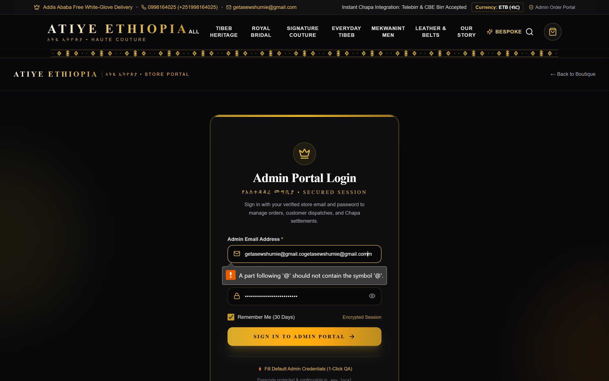
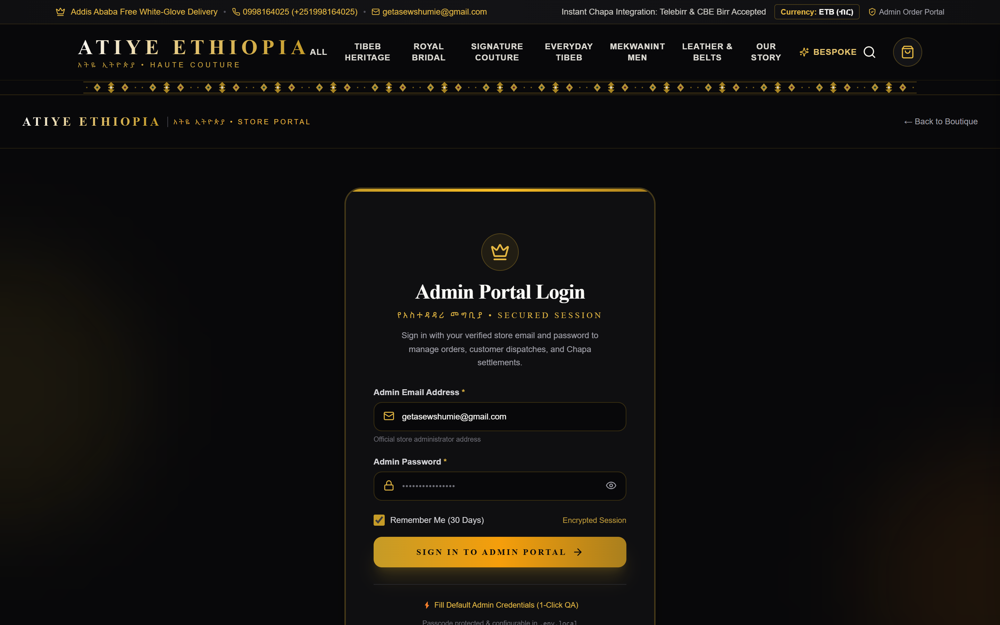

# 👑 ATIYE ETHIOPIA (አትዬ ኢትዮጵያ)
### Royal Ethiopian Haute Couture, Handspun Shemane Textiles & Modern Tibeb E-Commerce Platform

[](https://habesha-luxe.vercel.app)
[](https://habesha-luxe.vercel.app/admin/login)
[-00875A?style=for-the-badge)](https://chapa.co)
[](https://nextjs.org)
[](https://www.typescriptlang.org)
[](https://tailwindcss.com)

> **Atiye Ethiopia (አትዬ ኢትዮጵያ)** is a premier Ethiopian luxury couture and e-commerce storefront showcasing authentic handspun Habesha Kemis, royal bridal attire, men's Ejetebab & Gabi, and handcrafted highland leatherwork—powered by instant Chapa ETB payment integration and a real-time admin order management portal.

---

## 🌐 Verified Live Deployments & Portal Links

| Resource | Verified Live URL | Access / Description |
|---|---|---|
| **Live Storefront** | [https://habesha-luxe.vercel.app](https://habesha-luxe.vercel.app) | Public storefront with 6 Ethiopian traditional collections & Chapa checkout |
| **Admin Portal** | [https://habesha-luxe.vercel.app/admin/login](https://habesha-luxe.vercel.app/admin/login) | Secure Admin Order & Dispatch Management Dashboard |
| **GitHub Repository** | [https://github.com/gshumie/habesha-luxe](https://github.com/gshumie/habesha-luxe) | Production codebase & architectural documentation |
| **Official Contact** | `getasewshumie@gmail.com` • `+251998164025` | Store administration & bespoke bridal concierge |

> **Official Admin Login**:
> - **Admin Email**: `getasewshumie@gmail.com`
> - **Admin Password**: `SetYourStrongPassword2025!`

---

## 📸 Live Visual Showcase

### 1. Storefront Landing & The 6 Ethiopian Traditional Collections

*High-impact luxury hero section featuring the Imperial Bridal Gala Kemis, wedding season promotions (Up to 55% OFF), and dynamic collection filtering toolbar.*

---

### 2. Negestat Royal Bridal & Atiye Signature Couture

*Curated authentic Ethiopian cultural apparel including Royal Purple & Gold Star Tilf Kemis, Emerald & Gold Bullion Corset Gala Gowns, Crimson & Gold Couples Attire, and Gondar Meskel Wedding Kemis.*

---

### 3. Maison Story & Master Shemane Artisan Heritage

*Dedicated brand heritage section celebrating 3,000 years of Ethiopian textile history, 100% organic highland cotton spinning (ፈትል), and master weavers operating traditional wooden pedal looms in Shiro Meda and Chencha.*

---

### 4. Admin Order Management & Dispatch Portal
| Admin Dashboard (Real-Time KPIs & Dispatch Status) | Secure Admin Login Gate |
|:---:|:---:|
|  |  |
| *Real-time order tracking, Chapa revenue counter, dispatch updater, and order deletion controls.* | *Secure password gate with show/hide toggle, session persistence, and instant redirection.* |

---

## 🇪🇹 The 6 Signature Traditional Collections

Every piece at **Atiye Ethiopia (አትዬ ኢትዮጵያ)** is handcrafted by master *Shemane* (ሸማኔ) artisans from pure organic highland cotton, 24k gold metallic thread, and supple Ethiopian leather.

| Collection | Description & Featured Pieces | Preview |
|---|---|:---:|
| **1. Tibeb Heritage<br>*(የጥበብ ቅርስ)*** | Handwoven classic Habesha Kemis and Netela preserving ancestral Ethiopian geometric patterns.<br>• *Queen Menen Imperial Tibeb Kemis* (18,500 ETB)<br>• *Handspun Pure Cotton Netela & Shawl* (3,400 ETB) |  |
| **2. Negestat Royal Bridal<br>*(የነገሥታት እና የሰርግ ክብር)*** | Luxury 24k gold-embroidered wedding gowns, Melse attire, and matching couples outfits.<br>• *Imperial Royal Sheba Bridal Gala Kemis* (42,000 ETB)<br>• *Alluring Crimson & Gold Couples Matching Attire* (34,800 ETB)<br>• *Gondar Heritage Tilf Wedding Kemis* (22,000 ETB) |  |
| **3. Atiye Signature Couture<br>*(የአትዬ ልዩ ድምቀት)*** | Exclusive avant-garde evening wear blending traditional weaving with runway silhouettes.<br>• *Atiye Signature Emerald & Gold Bullion Gala Gown* (38,500 ETB)<br>• *Royal Purple & Gold Star Tilf Habesha Kemis* (24,500 ETB) |  |
| **4. Everyday Tibeb<br>*(የዕለት ተዕለት ጥበብ)*** | Lightweight modern Habesha tunics, day dresses, and contemporary lounge wear.<br>• *Modern Chic White Habesha Tunic with Yellow-Gold Embroidery* (14,000 ETB)<br>• *Everyday Crinkled Shemane Lounge Dress & Netela* (9,800 ETB) |  |
| **5. Mekwanint Men's Attire<br>*(የመኳንንት እና የወንዶች ጥበብ)*** | Noble Ethiopian men's Ejetebab tunics, linen shirts, and ceremonial four-layer Gabi shawls.<br>• *Traditional Mekwanint Ejetebab & Ceremonial Gabi Suit* (16,500 ETB)<br>• *Men's Imperial Linen Shirt & Gabi* (8,900 ETB) |  |
| **6. Royal Leather & Belt Craft<br>*(የቆዳ እና የመቀነት ጥበብ)*** | Handcrafted highland calfskin bags and traditional ceremonial waist belts (*Mekenet* / መቀነት).<br>• *Ethiopian Highland Calfskin Handbag* (7,500 ETB)<br>• *Handcrafted Royal Embossed Leather Mekenet Belt* (4,800 ETB) |  |

---

## 💳 Chapa Payment Architecture & Serverless Verification

1. **Instant Domestic & Diaspora Checkout**:
   - Supports **Telebirr**, **CBE Birr**, **Awash Birr**, and **Visa / Mastercard** through the Chapa Payment Gateway.
   - Built-in **Chapa Sandbox Gateway** (`/checkout/simulate-chapa`) for seamless local QA and automated testing without live credentials.
2. **Serverless Cold-Start Resilience**:
   - Dual-persistence engine stores pending order snapshots in client `localStorage` (`atiye_pending_order_${tx_ref}` and `atiye_completed_orders`).
   - If a stateless Vercel Lambda container recycles before verification, `/checkout/success` automatically transmits the fallback snapshot via `POST /api/payment/verify`, reconstructing and registering the order as `"paid"` on the server.
3. **Official Printable Tax Invoice**:
   - Route: `/checkout/success?tx_ref=...`
   - Itemized tax breakdown with ERCA TIN registration (`0048192841`), Chapa verification reference, delivery sub-city notes, and one-click PDF printing.

---

## 🛠️ Tech Stack & Engineering Highlights

- **Framework**: [Next.js 14](https://nextjs.org) (App Router, Server Actions, Serverless API Routes)
- **Language**: [TypeScript 5.6](https://www.typescriptlang.org) (Strict type safety across cart, order, and Chapa interfaces)
- **Styling**: [Tailwind CSS 3.4](https://tailwindcss.com) (Custom Obsidian & Ethiopian Gold palette `#0f0f11`, `#c59b27`)
- **Icons & Animation**: [Lucide React](https://lucide.dev) & [Canvas Confetti](https://github.com/catdad/canvas-confetti)
- **State Management**: [Zustand 5.0](https://github.com/pmndrs/zustand) with localStorage persistence (`atiye-ethiopia-cart-storage`)
- **Payment Gateway**: [Chapa API v1](https://chapa.co) (Transactions initialized in ETB)

---

## 🚀 Getting Started Locally

### Prerequisites
- **Node.js**: v18.17+ or v20+ (Tested on v24)
- **npm** or **pnpm** or **yarn**

### 1. Clone & Install
```bash
git clone https://github.com/gshumie/habesha-luxe.git
cd "habesha luxe"
npm install
```

### 2. Configure Environment Variables
Copy `.env.example` to `.env.local`:
```bash
cp .env.example .env.local
```

Configure your environment settings in `.env.local`:
```env
# Chapa API Keys (https://dashboard.chapa.co)
CHAPA_SECRET_KEY=CHASECK_TEST-demo-atiye-ethiopia-secret-key
CHAPA_PUBLIC_KEY=CHAPUBK_TEST-demo-atiye-ethiopia-public-key
NEXT_PUBLIC_CHAPA_PUBLIC_KEY=CHAPUBK_TEST-demo-atiye-ethiopia-public-key
CHAPA_WEBHOOK_SECRET=demo_webhook_secret_atiye

# Base URL
NEXT_PUBLIC_BASE_URL=http://localhost:3000

# Secure Admin Portal Credentials
ADMIN_EMAIL=getasewshumie@gmail.com
ADMIN_PASSWORD=SetYourStrongPassword2025!
ADMIN_JWT_SECRET=atiye_ethiopia_secret_secure_key_2025
ADMIN_SECRET_KEY=atiye-ethiopia-admin-2025

# Simulation Mode (fallback for offline demo)
NEXT_PUBLIC_ENABLE_SIMULATED_PAYMENT=true
```

### 3. Run Development Server
```bash
npm run dev
```
Open [http://localhost:3000](http://localhost:3000) in your browser.

### 4. Build for Production
```bash
npm run build
npm run start
```

---

## 📞 Maintainer & Atelier Contact Information

- **Brand**: Atiye Ethiopia (አትዬ ኢትዮጵያ) Couture Inc.
- **Maintainer**: **Getasew Shumie**
- **Store Email**: [getasewshumie@gmail.com](mailto:getasewshumie@gmail.com)
- **Direct Phone**: `0998164025` / `+251998164025`
- **Atelier Location**: Bole Medhanialem, Edna Plaza, 4th Floor, Addis Ababa, Ethiopia
- **Live Deployment**: [https://habesha-luxe.vercel.app](https://habesha-luxe.vercel.app)
- **GitHub Repository**: [https://github.com/gshumie/habesha-luxe](https://github.com/gshumie/habesha-luxe)
